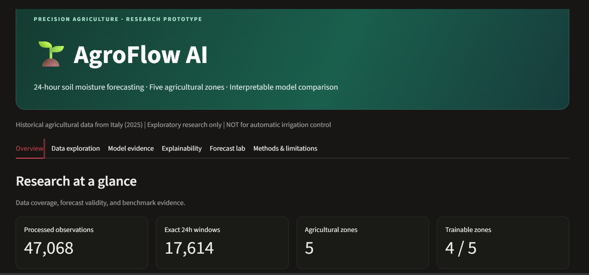
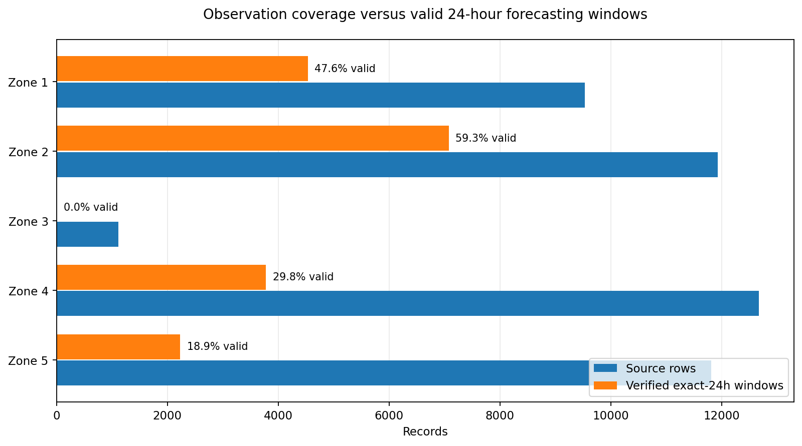
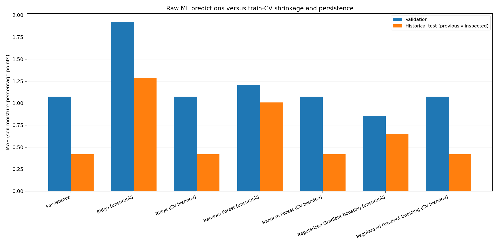
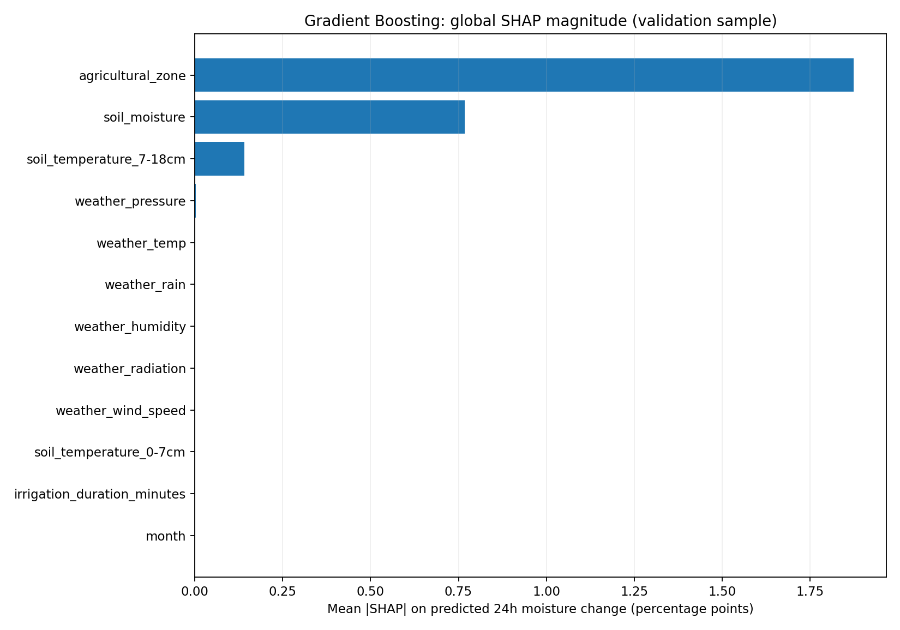

# 🌱 AgroFlow AI

### Explainable 24-Hour Soil Moisture Forecasting

**Precision agriculture · Time-series regression · IoT & weather data · Explainable AI · Streamlit**

An end-to-end **research prototype** that investigates whether machine learning can forecast soil moisture 24 clock-hours ahead more reliably than a simple persistence baseline. Built using historical agricultural sensor data from five sectors in Italy.



> [!IMPORTANT]
> **Research demonstration, not an irrigation controller.** Predictions are not field-validated, and the software must not be used to operate pumps or valves automatically.

**Explore:** [Data](#dataset--forecast-horizon) · [Method](#research-workflow) · [Results](#experimental-results) · [Explainability](#explainable-ai) · [Run locally](#reproduce-the-project) · [Limitations](#limitations) · [Attribution](#dataset-attribution)

## Research highlights

| Dataset / experiment | Verified result |
|---|---:|
| Preprocessed records across five zones | **47,068** |
| Records verified to correspond to exactly 24 hours | **17,614** |
| Zones usable for exact-24h prediction | **4 / 5** |
| Chronological training / validation / historical test rows | **11,813 / 2,213 / 2,643** |
| Phase 2 Gradient Boosting validation MAE | **0.855 pp** |
| Historical-test persistence MAE (best in this comparison) | **0.421 pp** |

*MAE is measured in soil-moisture **percentage points (pp)**, not classification accuracy. Lower is better. The windows overlap in time and are not independent trials.*

## The research question

**Can soil and weather measurements predict soil moisture exactly 24 hours later better than assuming the current moisture stays unchanged?**

The original publisher's targets were generated **144 observations ahead** on an intended 10-minute grid. Gaps can make 144 observations different from 24 elapsed hours. AgroFlow AI checks both the future timestamp and published target, retaining only samples that match a true 24-hour horizon. Future-looking columns including `water_vol_to_24h` and `real_moisture_delta` are excluded from predictive features to reduce leakage risk.

## Dataset & forecast horizon

The source is a **2025 agricultural IoT dataset from Arnesano, Italy**, covering soil moisture, temperature, weather and irrigation-related measurements across five cultivated sectors. The project uses the five **publisher-preprocessed** zone CSVs, not raw sensor data. The dataset is hosted on Mendeley Data; it is not redistributed in this code repository.



**Zone 3 is included in descriptive analysis but excluded from the 24-hour forecasting experiment** because no exact-24h windows were verified in the supplied preprocessed file.

## Research workflow

| Phase | Purpose | Entry point |
|---|---|---|
| **01 — Explore** | Zone coverage, soil moisture patterns, data quality and six visualizations | [`agroflow_phase1_eda.py`](agroflow_phase1_eda.py) |
| **02 — Benchmark** | Persistence vs Ridge, Random Forest and regularized Gradient Boosting; walk-forward analysis | [`agroflow_phase2_benchmark.py`](agroflow_phase2_benchmark.py) |
| **03 — Explain** | Permutation sensitivity and global/local SHAP explanations | [`agroflow_phase3_explain.py`](agroflow_phase3_explain.py) |
| **04 — Present** | Unified research dashboard with results, forecast demo and limitations | [`agroflow_dashboard_final.py`](agroflow_dashboard_final.py) |

Earlier development experiments are preserved separately in [`agroflow_train.py`](agroflow_train.py) and [`agroflow_train_v2.py`](agroflow_train_v2.py). The interactive forecast demo uses V1/V2 fitted locally; Phase 2 benchmarking is a distinct experiment.

## Experimental results

**Phase 2 unshrunk-model MAE (percentage points):**

| Model | Chronological validation | Previously inspected historical test |
|---|---:|---:|
| **Persistence (no-change)** | 1.076 | **0.421** |
| Ridge Regression | 1.924 | 1.288 |
| Random Forest | 1.209 | 1.008 |
| Regularized Gradient Boosting | **0.855** | 0.652 |



**How to interpret this:**

- Gradient Boosting improved upon persistence on **validation**, but the simple persistence baseline was better on the **historical test**.
- Train-only walk-forward selection assigned **zero learned-change weight** to each CV-blended model. Their resulting forecasts are **identical to persistence**, not separate ML victories.
- An earlier V2 experiment recorded validation MAE **0.563**, historical-test MAE **0.474**, compared with persistence historical-test MAE **0.421**.
- The historical-test segment had already been inspected during development. **These results are exploratory, not proof from a pristine independent holdout** or from a new agricultural season.

Detailed tables and findings are in [`phase2_outputs/`](phase2_outputs/) and [`PHASE2_FINDINGS.md`](phase2_outputs/PHASE2_FINDINGS.md).

## Explainable AI

SHAP and validation permutation sensitivity are used to describe **what the learned models rely on**, not to establish the physical causes of irrigation needs.

On 300 sampled validation rows, the unshrunk Phase 2 Gradient Boosting model's predicted moisture **change** was most sensitive to:

| Feature | Mean absolute SHAP magnitude |
|---|---:|
| Agricultural zone | 1.874 pp |
| Current soil moisture | 0.767 pp |
| Soil temperature, 7–18 cm | 0.142 pp |



The prominent **zone** effect raises a generalization concern: the model may be learning differences among known farm sectors instead of a robust soil-water mechanism. SHAP values are associations within a fitted model, **not causal agronomic claims**.

## Reproduce the project

**Requirements:** Windows PowerShell, Python 3.13, and the officially published five preprocessed CSV files. Running from the project root is important.

1. Clone this repository or download its ZIP.
2. Download **Version 2** of the [original dataset](https://data.mendeley.com/datasets/c837v6p8ph/2).
3. Put the five files in the following folders (create them if needed):

   ```text
   02_processed_data/
   └── preprocessed/
       ├── dataset_zone_1_preprocessed.csv
       ├── dataset_zone_2_preprocessed.csv
       ├── dataset_zone_3_preprocessed.csv
       ├── dataset_zone_4_preprocessed.csv
       └── dataset_zone_5_preprocessed.csv
   ```

4. Run the complete pipeline in this order:

   ```powershell
   python -m venv .venv
   .\.venv\Scripts\Activate.ps1
   python -m pip install -r agroflow_project_requirements.txt

   python agroflow_phase1_eda.py
   python agroflow_train.py
   python agroflow_train_v2.py
   python agroflow_phase2_benchmark.py
   python agroflow_phase3_explain.py
   python agroflow_phase4_check.py
   python -m streamlit run agroflow_dashboard_final.py
   ```

5. Streamlit should display a local URL (typically `http://localhost:8501`) to open in a browser.

**Generated outputs:** `agroflow_artifacts/` (local models), `phase1_outputs/`, `phase2_outputs/`, `phase3_outputs/`, and `phase4_outputs/`. Some curated charts and tables are already committed to this repository, but **models and the source dataset must be generated/downloaded locally**.

**Security:** only load `.joblib` model files produced by your own trusted run. Do not execute untrusted pickle/joblib binaries.

### Repository layout

```text
agroflow-ai-soil-moisture-forecast/
├── assets/                         # Streamlit dashboard screenshot
├── agroflow_dashboard_final.py     # Final research interface
├── agroflow_train.py               # Original ML experiment
├── agroflow_train_v2.py            # Regularized V2 experiment
├── agroflow_phase1_eda.py
├── agroflow_phase2_benchmark.py
├── agroflow_phase3_explain.py
├── agroflow_phase4_check.py
├── agroflow_project_requirements.txt
├── phase1_outputs/                # EDA figures and reports
├── phase2_outputs/                # Benchmark figures and reports
├── phase3_outputs/                # SHAP figures and reports
├── 02_processed_data/             # Download yourself; gitignored
│   └── preprocessed/
└── README.md
```

## Limitations

- This study uses **historical** data and publisher preprocessing, including filtering and interpolation. Some sensor issues remain documented in the dataset.
- Overlapping forecast windows can give deceptively large sample counts; only four of the five sectors had verified exact-24h targets.
- Some weather features are historical **ERA5 reanalysis**, not a live forecast feed. The future irrigation schedule and future rainfall are unknown in a real deployment.
- The historical test was already inspected in earlier iterations, so the reported comparison is **not independent validation**. New seasons and unseen sites are needed before reliability claims.
- SHAP and permutation results explain the fitted model's sensitivity, not whether irrigation should occur or why crops biologically need water.
- **No pump, valve, or live irrigation automation is provided.** This repository is a portfolio research prototype.

## Dataset attribution

The underlying sensor measurements and publisher preprocessing belong to the original dataset contributors, **not to this project**.

> Adamo, T., Colizzi, L., Dimauro, G., Guerriero, E., & Lomonte, N. (2026). *Soil Moisture, Irrigation Actuator and Weather Dataset from a Multi-Sector Precision-Irrigation* (Version 2) [Data set]. Mendeley Data. https://doi.org/10.17632/c837v6p8ph.2

**Dataset license: CC BY 4.0.** [Official dataset page](https://data.mendeley.com/datasets/c837v6p8ph/2). The publisher also requests citations to the associated research publications listed on that page. This repository provides independent experimental code and curated derived results; it does not redistribute the complete source data or declare a new license for the original measurements.

<details>
<summary>Related research publications requested by the dataset publisher</summary>

- Adamo, T., Colizzi, L., Dimauro, G., Guerriero, E., & Lomonte, N. (2026). *Empirical decision model learning for multi-sector greenhouse irrigation under water supply restrictions*. [DOI: 10.1016/j.atech.2026.102558](https://doi.org/10.1016/j.atech.2026.102558)
- Colizzi, L., Dimauro, G., Guerriero, E., & Lomonte, N. (2025). *Artificial intelligence and IoT for water saving in agriculture: A systematic review*. [DOI: 10.1016/j.atech.2025.101008](https://doi.org/10.1016/j.atech.2025.101008)
- Colizzi, L., Dimauro, G., Lomonte, N., & Mastronardi, L. (2026). *Predicting soil moisture in an urban garden using sensor data and machine learning techniques*. [DOI: 10.1007/978-3-032-16995-2_18](https://doi.org/10.1007/978-3-032-16995-2_18)

</details>

---

**Project status:** completed four-phase research portfolio demo · **Not field-ready** · No claim of production accuracy or automatic irrigation safety.
